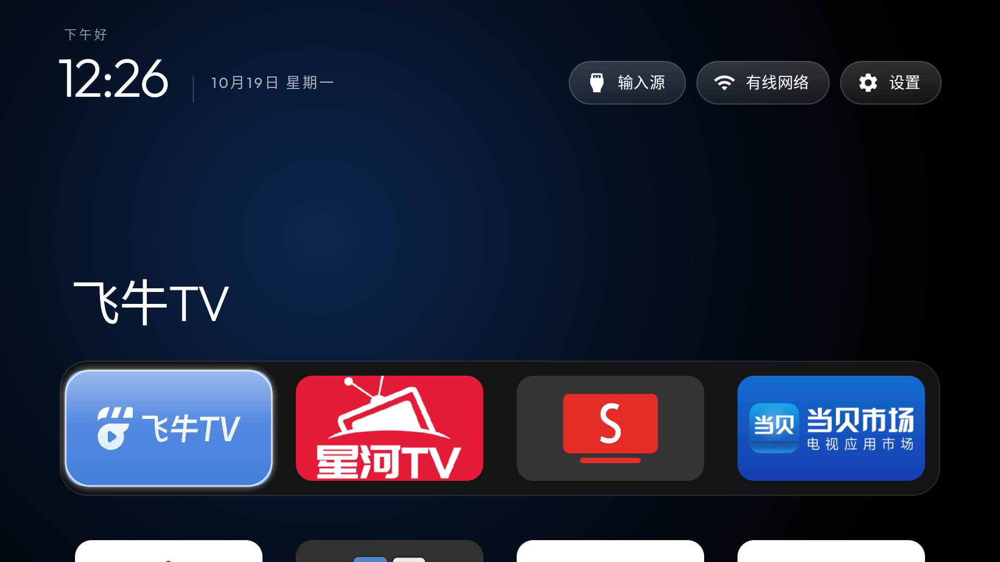

[简体中文](README.md) | [English](README.en.md)

---

# tvhome-zh · tv-vibehack 中文版

把 Android TV / Google TV 换成 **Apple TV（tvOS）风格**桌面的开源项目，完整简体中文本地化。

**本仓库是 [Gathin23/tv-vibehack](https://github.com/Gathin23/tv-vibehack) 的中文衍生版。**
原项目仅提供英文与德文，本仓库补充了完整简体中文翻译。遵循原项目 MIT 许可证，
版权归原作者 Gathin 所有（见 [LICENSE](LICENSE) 与 [NOTICE](NOTICE.md)）。

## 📦 下载

**➜ [下载最新版 tvhome-zh APK](https://github.com/mclhm8182/tvhome-zh/releases/latest)** · 仅 **1.6 MB**，纯 Java，无广告 SDK

前往 [Releases 页面](https://github.com/mclhm8182/tvhome-zh/releases) 查看全部版本。

## 这是什么

把电视盒子臃肿的广告桌面换成一个干净的、苹果 tvOS 观感的桌面：

- **纯黑背景 + 底部四格 Dock**（tvOS 那个浅色圆角条的位置）
- **顶部大字显示**当前聚焦的应用名，带一圈取自应用封面的氛围光
- **按「下」键**应用网格从底部滑出
- **一块悬浮玻璃高光**，在图标之间弹性移动，而不是每个格子各画各的边框
- **三个磨砂按钮**：输入源（HDMI / AV / 直播电视）、Wi-Fi、设置
- **问候语 + 大号细体时钟 + 日期**（Outfit 字体）
- 可选的**时钟屏保**，防止烧屏

**无广告、无账号、无需 root、无需数据线**，纯 ADB 覆盖安装，一条命令可还原。

### 📦 轻量

安装包仅 **1.6 MB**（APK，调试版未压缩），比同类的 TV 桌面轻得多——
纯 Java 实现、仅依赖 `recyclerview` 与 `dynamicanimation` 两个轻量 AndroidX 库，
**没有引入 Compose / Glance 等重型框架，也没有内置广告 SDK 或推荐引擎**。
在 2 GB 内存的国产盒子上实测常驻内存约 **107 MB（PSS）**，运行流畅不拖后腿。
对内存吃紧的低配盒子来说，体积小本身就是优势——装它几乎不占空间。

### 中文版实机截图

在国产电视盒子上运行的样子（简体中文界面）：



<details>
<summary>对比：原厂广告桌面（左） vs 本项目桌面（右）</summary>


</details>

## 相对原版的改动

| 改动 | 说明 |
|---|---|
| 🇨🇳 简体中文 | 补齐 20 条文案（问候语、输入源、设置、Wi-Fi 状态、错误提示等）与中文日期格式。资源文件：[`values-zh/strings.xml`](launcher/app/src/main/res/values-zh/strings.xml) |
| ⭐ 常用应用可编辑 | **按遥控器菜单键**（或点顶部「常用」按钮）打开面板，勾选/取消常用应用，所见即所得；也可**长按**任意图标快速置入或移出。改动保存在电视本地，不用改文件、不用重新编译 |
| 🎨 主题覆盖机制 | 移植上游的 `config.json` 覆盖层：把配置（Dock、列数、背景色等）写成 `config.json` 推到电视即可生效，**换主题不用重新编译** |

除此之外与上游一致，**默认配置保持通用**，适合任意品牌电视盒子。

### ⭐ 编辑常用应用（底部 Dock）

Dock 就是底部那一排常用应用。两个入口，随你喜欢：

- **按遥控器菜单键**（有些遥控器叫「选项」/长按菜单）→ 弹出「常用应用」面板，列出全部已装应用，已固定的带勾，点一下切换；
- **长按任意应用图标** → 直接置入 Dock；Dock 已满时点它会顶替第一个位置。

选择保存在电视本地，**下次开机依然有效**。想清空就在面板里逐个取消勾选。

### 🎨 换主题 / 换壁纸（不用重新编译）

桌面启动时会自动读取电视上的这个目录（可放`config.json` 和 `wallpaper.jpg`）：

```
/sdcard/Android/data/com.gathin.tvhome/files/
```

- 放一张 `wallpaper.jpg` → 重启桌面即成为背景（删掉即恢复纯黑）；
- 放一个 `config.json` → 覆盖 Dock、列数、背景色等内置默认值。

仓库里的 [`tools/set-wallpaper.sh`](tools/set-wallpaper.sh) 是一键换壁纸脚本（`./set-wallpaper.sh <电视IP> <图片路径>`）。

## 为什么选它：Android 11 兼容性的一个细节

很多国产 TV 应用在 Android 11 上会出现「应用列表只显示几个 App」的问题——这是
**Android 11 包可见性**（package visibility）限制：应用必须声明 `<queries>` 才能看到其他应用。
本项目 `targetSdk 29`，在 Android 11 上属于「旧版行为」，能正常枚举全部应用，无需额外声明。

这在国产盒子（普遍停留在 Android 11）上尤其重要。

## 安装

无需数据线，电视和电脑在同一局域网下：

```bash
# 1. 电视：设置 → 关于 → 连按「版本号」7 次 → 开发者选项 → 打开「USB 调试」
# 2. 电脑：连上电视
adb connect <电视IP>:5555

# 3. 安装并设为默认桌面
adb install -r tvhome-zh-debug.apk
adb shell pm grant com.gathin.tvhome android.permission.ACCESS_FINE_LOCATION
adb shell cmd package set-home-activity com.gathin.tvhome/.MainActivity

# 4. 按 Home 键即可看到新桌面
```

也可以用原项目自带的脚本：`TV_HOST=<电视IP> ./launcher/build-and-install.sh`

### 还原

```bash
adb shell cmd package set-home-activity <原桌面组件名>
```

## 自定义

需要改的东西都在 [`config.xml`](launcher/app/src/main/res/values/config.xml)，改完重新编译即可：

- `dock_apps` —— 底部 Dock 固定的应用（**默认留空**，留空则应用按名称排序）
- `live_tv_package` —— 「直播电视」输入源对应的应用包名（默认留空＝不显示该入口）
- `hidden_apps` —— 不出现在网格中的应用（默认留空）
- `columns` —— 网格每行几个图标（默认 4）

包名怎么查？电视上执行 `adb shell pm list packages`。

## 从源码编译

需要**完整 JDK**（不是 JRE，AGP 需要 `jlink`）与 Android SDK：

```bash
# JDK 21（Temurin）
# Android SDK：platforms;android-34（或 35）+ build-tools

cd launcher
./gradlew assembleDebug
# 产物：app/build/outputs/apk/debug/app-debug.apk
```

> **踩坑提示**：如果 `$HOME/.android` 目录不可写（常见于曾用 root 跑过 Android 工具的机器），
> debug 签名会失败。解决：生成一个 keystore，并在 `app/build.gradle` 里加 `signingConfigs.debug` 指向它。

## 已知问题

- 部分电视 ROM 在应用启动瞬间会残留一个透明的「启动中」占位窗（`APPLICATION_ATTACHED_DIALOG`），
  吃掉按键，表现为「遥控器没反应」。解除：`adb shell am force-stop com.gathin.tvhome` 再重新启动。

## 致谢

- **[Gathin23/tv-vibehack](https://github.com/Gathin23/tv-vibehack)** —— 原始项目，MIT 许可证，
  作者 Gathin。本仓库的绝大部分代码来自它，感谢这份优秀的开源工作。
- [Outfit](https://fonts.google.com/specimen/Outfit) 字体，SIL Open Font License
  （见 `launcher/FONT-LICENSE-OFL.txt`）。

## 许可

MIT。原项目版权 (c) 2026 Gathin，本地化改动版权 (c) 2026 mclhm8182。